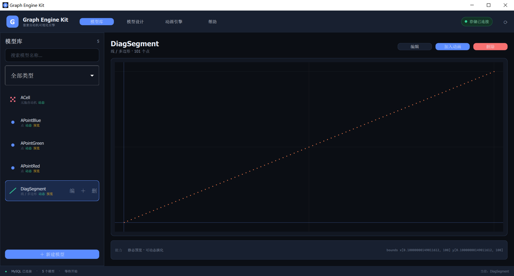
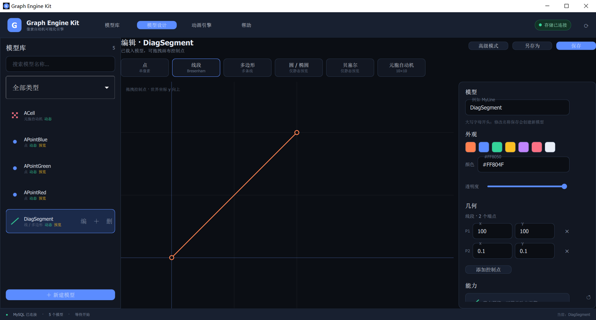
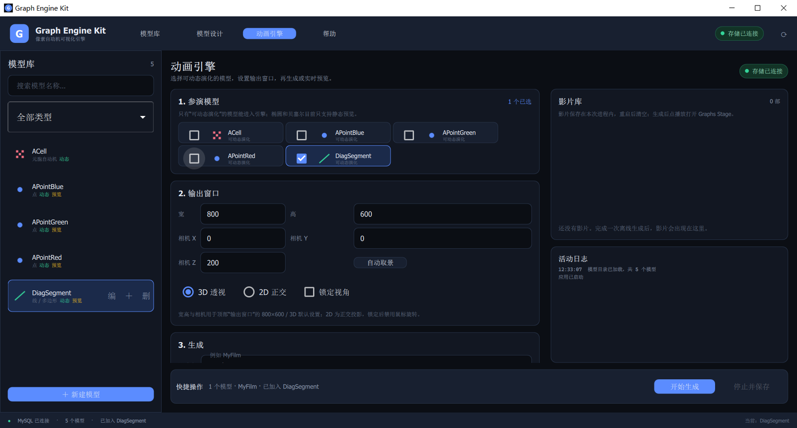
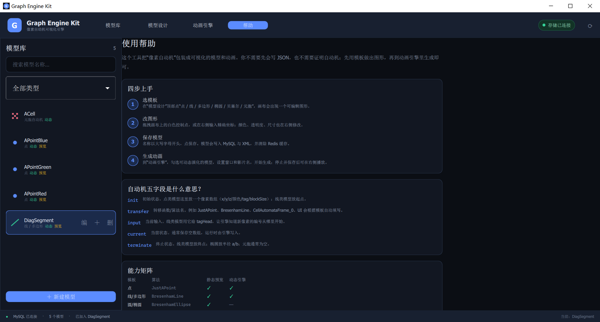
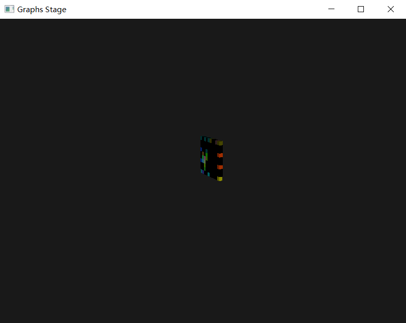
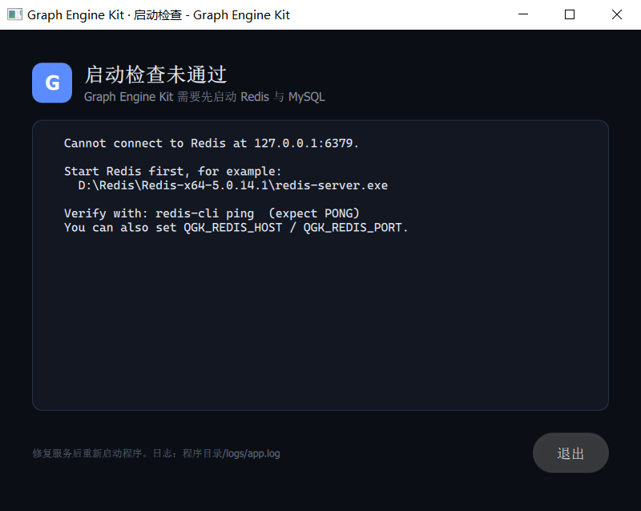

# Qt Graph Engine Kit

> 用自动机驱动像素、把“数学 + 自动机”模型可视化并生成 OpenGL 动画的 Windows 桌面工具。

Qt Graph Engine Kit 把每个像素看成一个自动机，用 `init / transfer / input / current / terminate` 五个字段描述它如何生成、移动、合并和记录，最终把一帧帧像素数据交给 OpenGL 播放。项目原本需要手写 XML/JSON 和自动机字段；现在提供模板、画布、属性检查器和动画向导，普通使用者可以先做出图形，再进入引擎生成影片。

## 目录

- [1. 功能概览](#1-功能概览)
- [2. 界面](#2-界面)
- [3. 技术栈与架构](#3-技术栈与架构)
- [4. 环境要求](#4-环境要求)
- [5. 五分钟快速开始](#5-五分钟快速开始)
- [6. 详细配置](#6-详细配置)
- [7. 构建](#7-构建)
- [8. 部署与运行](#8-部署与运行)
- [9. 使用指南](#9-使用指南)
- [10. 模型数据格式](#10-模型数据格式)
- [11. 目录结构](#11-目录结构)
- [12. 故障排查](#12-故障排查)
- [13. 已知限制](#13-已知限制)
- [14. 备份、升级与清理](#14-备份升级与清理)
- [15. 验收清单](#15-验收清单)
- [16. 许可证与第三方库](#16-许可证与第三方库)

## 1. 功能概览

- **模型库**：搜索、类型筛选、静态预览、编辑、删除、加入动画。
- **模型设计**：点、线段、折线/多边形、圆/椭圆、贝塞尔、元胞自动机模板；画布拖拽控制点，右侧精确编辑坐标/颜色/透明度；高级模式可直接编辑五字段自动机 JSON。
- **动画引擎**：选择模型、设置输出窗口/相机/2D 或 3D、命名为影片、离线逐帧生成或实时 3D 预览；生成完的影片可在 Graphs Stage 中播放。
- **自动取景**：默认相机距离 200；点击“自动取景”按当前预览范围估算；启动时若相机仍为默认值，会按参演模型范围自动调整。
- **数据持久化**：模型保存到 MySQL，同时写 XML；Redis 作为点阵渲染缓存，保存/删除时自动失效。
- **故障自愈**：数据库路径存在但 XML 丢失/损坏时，自动按数据库记录重建 XML，不再把模型从列表中删除。
- **启动预检**：启动前检查 Redis 6379 与 MySQL 3306，失败时显示带命令提示的错误页，而不是静默退出。

## 2. 界面

### 模型库

左侧是模型目录；右侧是自动适配的大预览、模型元数据和操作按钮。预览使用世界坐标（y 向上），带网格和坐标轴。

### 模型设计

顶部模板条直接生成可视化图形；中间画布支持拖拽控制点；右侧检查器修改名称、颜色、透明度、坐标、半径等。高级模式提供五字段 JSON 编辑器。

### 动画引擎

选择可动态演化的模型，设置输出窗口和相机，选择“离线生成”或“实时预览”，底部快捷操作栏始终可见。生成的影片出现在右侧影片库。

### 帮助

内置四步上手、自动机五字段解释、能力矩阵和 3D 窗口操作说明。

### Graphs Stage

独立的 GLFW/OpenGL 窗口；离线影片播放和实时渲染共用该窗口。

## 3. 技术栈与架构

| 层 | 技术 |
|---|---|
| UI | Qt 6.8 Quick / QML / Qt Quick Controls 2（Material 深色风格） |
| 应用逻辑 | C++20 / Qt Core / 信号槽 / 协程（`ModelGenerator`） |
| 渲染 | OpenGL 3.3 Core / GLFW / GLAD / GLM |
| 模型加载 | Assimp（外部模型）、TinyXML2、nlohmann/json |
| 存储 | MySQL 8（模型索引/自动机）、Redis（点阵缓存）、XML（蓝图文件） |
| 基础库 | ShabbyThreadPool / ShabbyEventQueue / ShabbyFileManager / ShabbyRedis / ShabbyDataBase |
| 构建 | CMake ≥ 3.21 + Visual Studio 2022 x64 |

数据流：

~~~text
QML UI
  │ 保存模型：五字段 JSON
  ▼
GraphFactory ──► MySQL（ModelBluePrint / FilePath / Automata）
  │                 └──► XML 蓝图（resources/xmls/graphAutomata）
  │
  ├── 预览：Request4ModelPreview → RenderCU 静态算法 → 归一化点集 → QML Canvas
  │
  └── 动画：GraphStudio → GraphAgency（协程）
                         → Hall（舞台）
                         → Law（像素规则）
                         → PhotoGrapher（胶片）
                         → GLScreen（OpenGL 播放）
                         → Graphs Stage
~~~

## 4. 环境要求

- Windows 10/11 x64。
- Visual Studio 2022，安装“使用 C++ 的桌面开发”工作负载（MSVC v143 + Windows 10/11 SDK）。
- CMake 3.21 或更高（本项目在 3.31.1 上验证）。
- Qt 6.8 MSVC 2022 64-bit，至少包含：
  - Qt Quick
  - Qt Quick Controls 2
  - Qt Network
  - Qt Qml XmlListModel（随 Qt 安装）
- MySQL 8.x（本项目在 8.0.31 上验证）。
- Redis 5.x 或更高（本项目在 5.0.14.1 上验证）。
- 支持 OpenGL 3.3 的显卡/驱动；远程桌面或虚拟机若没有硬件 OpenGL，可能无法打开 Graphs Stage。

当前机器上的参考路径：

| 组件 | 路径 |
|---|---|
| Qt | `D:\QtComponents\6.8.0\msvc2022_64` |
| CMake | `D:\CMake\bin\cmake.exe` |
| Redis | `D:\Redis\Redis-x64-5.0.14.1` |
| MySQL | `C:\Program Files\MySQL\MySQL Server 8.0\bin\mysql.exe` |

## 5. 五分钟快速开始

1. **启动 MySQL 服务**（管理员 PowerShell）：

   ~~~powershell
   Start-Service MySQL80
   Get-Service MySQL80
   ~~~

2. **初始化数据库**（首次安装；已有数据库可跳过）：

   ~~~powershell
   cd F:\WorkPlace\VS\QtGraphEngineKit
   Get-Content sqls\schema.sql -Raw | & "C:\Program Files\MySQL\MySQL Server 8.0\bin\mysql.exe" -u root -p --default-character-set=utf8mb4
   Get-Content sqls\seed.sql   -Raw | & "C:\Program Files\MySQL\MySQL Server 8.0\bin\mysql.exe" -u root -p --default-character-set=utf8mb4
   ~~~

   也可以使用脚本：

   ~~~powershell
   powershell -ExecutionPolicy Bypass -File scripts\init-db.ps1 -WithSeed
   ~~~

3. **启动 Redis**：

   ~~~powershell
   cd D:\Redis\Redis-x64-5.0.14.1
   .\redis-server.exe
   ~~~

   另开窗口验证：

   ~~~powershell
   .\redis-cli.exe ping
   # PONG
   ~~~

4. **构建并安装**：

   ~~~powershell
   cd F:\WorkPlace\VS\QtGraphEngineKit
   .\construct_project.bat
   ~~~

   或手动：

   ~~~powershell
   cmake -S . -B build -G "Visual Studio 17 2022" -A x64 `
         -DCMAKE_PREFIX_PATH="D:/QtComponents/6.8.0/msvc2022_64"
   cmake --build build --config Debug --parallel
   cmake --install build --config Debug
   ~~~

5. **运行**：

   ~~~powershell
   cd F:\WorkPlace\VS\QtGraphEngineKit\install\bin
   .\QtGraphEngineKit.exe
   ~~~

   或在项目根目录：

   ~~~powershell
   powershell -ExecutionPolicy Bypass -File scripts\run.ps1
   ~~~

启动成功后：顶部显示“存储已连接”，左侧出现 5 个演示模型；选中模型即可预览，点“加入动画”进入引擎。

## 6. 详细配置

### 6.1 MySQL

服务名通常为 `MySQL80`。启动并验证：

~~~powershell
Start-Service MySQL80
Get-Service MySQL80
Test-NetConnection 127.0.0.1 -Port 3306
~~~

创建数据库和表：

~~~powershell
mysql -u root -p --default-character-set=utf8mb4 < sqls\schema.sql
~~~

可选演示数据（会覆盖同名演示模型的自动机行/XML 路径，执行前备份）：

~~~powershell
mysql -u root -p --default-character-set=utf8mb4 < sqls\seed.sql
~~~

验证：

~~~sql
USE meta_graph_model;
SHOW TABLES;
SELECT name FROM ModelBluePrint;
SELECT COUNT(*) FROM Automata;
~~~

默认连接参数（代码内默认值）：

| 参数 | 默认值 |
|---|---|
| host | 127.0.0.1 |
| user | root |
| password | 123456 |
| database | meta_graph_model |

可用环境变量覆盖，无需改代码：

~~~powershell
$env:QGK_DB_HOST="127.0.0.1"
$env:QGK_DB_USER="root"
$env:QGK_DB_PASSWORD="123456"
$env:QGK_DB_NAME="meta_graph_model"
~~~

> 代码中的 MySQL 连接初始化在连接失败时会重试；请务必先启动 MySQL，否则程序可能停在启动阶段。

### 6.2 Redis

Redis 是硬依赖，既不是可选项，也不是持久化主存储。模型数据在 MySQL/XML 中，Redis 只缓存渲染点集。

~~~powershell
cd D:\Redis\Redis-x64-5.0.14.1
.\redis-server.exe
.\redis-cli.exe ping
~~~

清理缓存（修改模型后若看到旧预览）：

~~~powershell
.\redis-cli.exe FLUSHDB
~~~

覆盖地址/端口：

~~~powershell
$env:QGK_REDIS_HOST="127.0.0.1"
$env:QGK_REDIS_PORT="6379"
~~~

启动预检会连接 Redis 6379 和 MySQL 3306。排障时可跳过：

~~~powershell
$env:QGK_SKIP_PREFLIGHT="1"
~~~

### 6.3 Qt / CMake / Visual Studio

1. 安装 Qt 6.8 MSVC 2022 64-bit；确保 `qmake6` 在 PATH 中，或构建时传 `-DCMAKE_PREFIX_PATH`。
2. 安装 VS2022 C++ 工作负载与 Windows SDK。
3. 确认：

   ~~~powershell
   cmake --version
   qmake6 -query QT_INSTALL_PREFIX
   where cl
   ~~~

4. 当前 CMake 会链接 `libs/*.lib`，并在构建后把 `dlls/*.dll` 复制到输出目录；安装时复制到 `install/bin`。
5. 新增 `cpps/*.cpp` 后，由于使用 `file(GLOB)`，必须重新运行 CMake 配置（`construct_project.bat` 会自动重配）。

## 7. 构建

### 7.1 一键脚本

~~~bat
construct_project.bat
~~~

脚本会：

1. 检查 `cmake` 与 `qmake6`。
2. 从 `qmake6 -query QT_INSTALL_PREFIX` 自动得到 Qt 前缀。
3. 配置 `build`，构建 Debug。
4. 执行 `cmake --install`，通过 Qt 部署脚本把 Qt DLL、platforms、QML 模块复制到 `install`。

### 7.2 手动构建

~~~powershell
cmake -S . -B build -G "Visual Studio 17 2022" -A x64 `
      -DCMAKE_PREFIX_PATH="D:/QtComponents/6.8.0/msvc2022_64"
cmake --build build --config Debug --parallel
cmake --install build --config Debug
~~~

如果 CMake 缓存来自旧 Qt/旧路径，删除 `build` 后重试。

### 7.3 部署结构

Qt 部署脚本会在 `install` 下生成：

~~~text
install/
  bin/
    QtGraphEngineKit.exe
    Qt6*.dll
    resources/           # QML、图片、XML、演示模型
    shaders_codes/       # OpenGL 着色器
    logs/app.log         # QML/警告日志
  plugins/               # platforms、imageformats 等
  qml/                   # Qt Quick / Controls / Material 模块
  qt.conf
~~~

程序的工作目录必须是 `install/bin`（XML 与着色器使用相对路径）。

## 8. 部署与运行

- 直接运行：`install\bin\QtGraphEngineKit.exe`。
- 也可以用 `scripts\run.ps1`：会检查 Redis/MySQL，启动 Redis（如果找到），再启动程序。
- 不要从任意目录双击 exe；工作目录不对会导致找不到 `resources` 或 `shaders_codes`。

- 启动失败时：
  - 先看启动错误页（Redis/MySQL 端口）。
  - 再看 `install/bin/logs/app.log`（QML 警告/消息）。
  - C++ 后端的 `std::cerr` 输出显示在程序附带的控制台窗口。
- 如果 Qt DLL 缺失，可在 Qt 命令行中执行：

  ~~~powershell
  windeployqt --qmldir resources install\bin\QtGraphEngineKit.exe
  ~~~

  本项目正常安装时已自动部署；该命令仅作兜底。

## 9. 使用指南

### 9.1 模型库

- 顶部搜索框按名称即时过滤。
- 类型下拉：全部 / 点 / 线或多边形 / 曲线 / 元胞 / 其他。
- 单击行选择模型；双击行进入设计器。
- 行右侧按钮：编（编辑）、＋（加入动画引擎）、删（删除，带确认）。
- 主区域显示预览、点数和边界；ACell 没有静态预览，会提示“运行时演化”。

### 9.2 模型设计

1. 从顶部模板选择：点、线段、多边形、圆/椭圆、贝塞尔、元胞自动机。
2. 在画布上拖拽白色控制点；y 向上，适合引擎坐标。
3. 右侧修改：
   - 模型名：大写字母开头，只含字母/数字/下划线。修改名称后保存会创建新模型。
   - 颜色：调色板或 `#RRGGBB`。
   - 透明度：0.05–1.0。
   - 几何：每个控制点的 x/y；椭圆半径；多边形闭合。
   - 能力：显示是否支持静态预览/动态引擎。
4. 点“保存”或“另存为”。保存后自动写 XML、MySQL，并清除该模型的 Redis 缓存。
5. 高级模式：
   - 直接编辑五字段 JSON；保存前会校验 JSON 数组结构。
   - 适合自定义算法参数或导入已有自动机数据。

### 9.3 动画引擎

1. 勾选“参演模型”。只有“可动态演化”的模型可选；椭圆/贝塞尔仅静态预览。
2. 设置宽高、相机 X/Y/Z、2D/3D、锁定视角，以及**鼠标视角方式**：
   - **自由视角**：窗口获得焦点时移动鼠标即可旋转（默认，保留旧行为）。
   - **点击拖拽**：按住鼠标左键拖动才旋转，松开即停；不会因为鼠标在窗口外移动而转动。
   - 勾选“锁定视角”后两种方式都禁用旋转。
   - 默认相机 Z=200。
   - 若保持默认相机且 X/Y 为 0，点击“开始生成”时会按参演模型范围自动取景。
   - 也可以点“自动取景”手动应用当前预览范围。
3. 输入影片名（字母或下划线开头，字母/数字/下划线）。
4. 选择模式：
   - **离线生成并保存**：逐帧生成；停止后影片进入右侧影片库。这是可回放的影片。
   - **实时预览（不保存影片）**：打开独立的 Graphs Stage 窗口，实时交互；关闭窗口后不生成影片。当前实时预览只支持元胞自动机（ACell）；点/线模型请使用“离线生成并保存”。
5. 点“开始生成”，等待状态变为“生成中”；点“停止并保存”（或模型自然结束）后影片出现在影片库。
6. 点影片的“播放”打开 Graphs Stage；按 Esc 或关闭窗口返回。
7. 实时窗口操作：
   - W/A/S/D 前后左右，Q/E 上下。
   - 自由视角：移动鼠标旋转；点击拖拽：按住左键拖动旋转。
   - 滚轮缩放 FOV；窗口失焦时不会响应鼠标/滚轮。
   - I/K 绕 X，J/L 绕 Z，U/O 绕 Y。
   - Esc 关闭（窗口获得焦点时）；也可以点窗口关闭按钮。

### 9.4 3D 取景与空白画面

Graphs Stage 使用相机看向原点、透视投影。相机距离过远会超过远裁剪面（已改为随距离动态扩展），过近则模型很大或穿过相机。若画面空白：

1. 回到引擎页点“自动取景”，或在相机 Z 填 30–90 后重新生成/播放。
2. 确认模型坐标没有远离原点（例如点模型在 160,160 时，默认 200 相机可看到，但较小）。
3. 确认影片确实保存（影片库有名称）；实时预览不保存影片。
4. 查看控制台/日志是否有 “No frames to render.”。

## 10. 模型数据格式

一个模型 = 一个或多个自动机。每个自动机包含五个字符串字段：

| 字段 | 含义 | 点示例 | 线示例 |
|---|---|---|---|
| init | 初始状态 | `[{"x":160,"y":160,...}]` | 起点数组 |
| transfer | 算法名 | `JustAPoint` | `BresenhamLine` |
| input | 当前输入 | `[]` | `[{"tagHead":100}]` |
| current | 当前状态 | 通常 `[]` | 通常 `[]` |
| terminate | 终止状态 | `[]` | 终点数组 |

像素字段：

~~~json
{
  "x": 160, "y": 160, "z": 0,
  "r": 1.0, "g": 0.5, "b": 0.31, "a": 1.0,
  "tag": 100, "blockSize": 1.0
}
~~~

支持的算法：

| 模板 | transfer | 静态预览 | 动态引擎 | 说明 |
|---|---|---|---|---|
| 点 | `JustAPoint` | ✓ | ✓ | 单像素 |
| 线段 | `BresenhamLine` | ✓ | ✓ | 逐点协程 |
| 折线/多边形 | 多条 `BresenhamLine` | ✓ | ✓ | 每条边一个自动机 |
| 圆/椭圆 | `BresenhamEllipse` | ✓ | — | 后端没有 Co 版本 |
| 贝塞尔 | `PartitionBezierCurve` | ✓ | — | 后端没有 Co 版本 |
| 元胞自动机 | `CellAutomataFrame_0` | — | ✓ | 10×10，随机初始；输出存活与死亡细胞 |

存储关系：

- MySQL `ModelBluePrint`：模型名。
- MySQL `FilePath`：XML 路径。
- MySQL `Automata`：五字段数据。
- Redis：以模型名为 key 的渲染点集缓存。
- XML：蓝图文件，位于 `resources/xmls/graphAutomata`；缺失时程序会按数据库重建。

> XML 中的 JSON 字段使用反斜杠转义引号（例如 `init_status='[{\"x\":1}]'`），这是本项目解析器的约定；手工编辑时请保持。

## 11. 目录结构

~~~text
QtGraphEngineKit/
  cpps/                 C++ 实现
  headers/              项目头文件 + 第三方头（assimp/glm/GLFW/...）
  libs/ dlls/           预编译依赖
  resources/qmls/       新 QML UI（MainPage / components / views / editor / preview）
  resources/xmls/       模型 XML 示例/演示
  shaders_codes/        GLSL
  sqls/                 schema.sql / seed.sql / 建表历史脚本
  scripts/              check-env.ps1 / run.ps1 / init-db.ps1
  docs/images/          README 截图
  docs/UI_DESIGN.md     界面设计说明
  install/              安装产物（被 .gitignore 忽略）
  build/                构建产物（被 .gitignore 忽略）
~~~

## 12. 故障排查

| 现象 | 原因 | 处理 |
|---|---|---|
| 启动页提示 Cannot connect to Redis | Redis 未启动/端口不对 | 启动 `redis-server.exe`；`redis-cli ping`；检查 `QGK_REDIS_*` |
| 启动页提示 Cannot connect to MySQL | MySQL80 未启动 | `Start-Service MySQL80`；检查 3306 |
| 启动后无窗口/卡住 | MySQL 账号/库名错误，连接重试 | 用 mysql 客户端验证 `meta_graph_model`；设置 `QGK_DB_*`；查看控制台 |
| 预览空白，但模型列表正常 | XML 缺失/损坏、模型无静态点 | 刷新；编辑后保存；检查数据库和 XML；ACell 本身无静态预览 |
| 预览时提示 DeSerialization failed | 旧 XML 格式/路径错误 | 程序会尝试按数据库重建；若失败，检查 `Automata` 行；Redis 可 `FLUSHDB` |
| 保存后模型没出现 | 名称不合规/数据库失败 | 名称需大写字母开头；看 Toast 和控制台；检查 MySQL |
| 删除后模型仍出现 | 数据库事务失败/缓存 | 刷新；检查 MySQL；`redis-cli DEL <name>` |
| Graphs Stage 空白 | 相机过近/过远、影片无帧 | 用“自动取景”或相机 Z=30–90；确认影片库存在；重新生成 |
| 实时窗口无法 Esc | 窗口未获得焦点 | 先点一下窗口再按 Esc；或点关闭按钮 |
| 主界面在 3D 窗口期间卡住 | 现有架构在 UI 线程阻塞 | 正常现象；关闭窗口后恢复 |
| 缺少 Qt 平台插件/QML 模块 | 未部署或工作目录不对 | 从 `install/bin` 启动；确认 `install/plugins`、`install/qml`；必要时 `windeployqt` |
| 中文乱码/编译警告 | 源码编码混杂 | 本项目 C++ 源为 CP936/GBK，QML/README 为 UTF-8；不要用 UTF-8 覆盖整个 C++ 文件 |

日志位置：

- `install/bin/logs/app.log`：QML 消息、Qt 警告。
- 控制台窗口：C++ `std::cerr`（模型解析、GL、数据库错误）。

## 13. 已知限制

- **实时预览不保存影片**；只有“离线生成并保存”的影片可回放。
- 实时渲染在 UI 线程中阻塞主界面，关闭 Graphs Stage 后恢复。
- 实时预览目前只对元胞自动机（ACell）开放；点/线等有限协程模型请使用离线生成并播放，避免实时循环结束时触发后端有限状态机清理问题。
- 影片只保存在当前进程内，重启后清空。
- 椭圆/贝塞尔没有动态协程算法，只能静态预览。
- 元胞自动机初始状态随机；UI 的 10×10 网格编辑只影响模板显示，不改变后端随机初始规则。
- 默认 MySQL 弱口令为本地开发便利，生产环境请用环境变量并限制网络访问。
- 没有登录、权限、多用户、撤销历史持久化、MSI 安装包。

## 14. 备份、升级与清理

备份：

~~~powershell
mysqldump -u root -p meta_graph_model > backup_meta_graph_model.sql
Copy-Item install\bin\resources\xmls\graphAutomata backup_xml -Recurse
~~~

升级代码后：

~~~powershell
cmake --build build --config Debug --parallel
cmake --install build --config Debug
~~~

旧数据库兼容：程序会自动补建/重建缺失 XML；如字段结构与当前版本不一致，先备份再手工迁移。

清空模型（谨慎）：

~~~powershell
mysql -u root -p --default-character-set=utf8mb4 < sqls\TruncateAll.sql
& "D:\Redis\Redis-x64-5.0.14.1\redis-cli.exe" -n 0 FLUSHDB
~~~

（最后一行请用实际 redis-cli 路径；也可以直接 `redis-cli FLUSHDB`。）

## 15. 验收清单

- [ ] `construct_project.bat` 配置/构建/安装成功。
- [ ] 从 PATH 移除 Qt 后 `install\bin\QtGraphEngineKit.exe` 仍能启动（独立部署）。
- [ ] 停 Redis 启动时显示启动错误页，而不是静默退出。
- [ ] 模型库显示 5 个演示模型；预览点/线正常；ACell 显示运行时提示。
- [ ] 新建模型、保存、重启后仍在；修改颜色后预览更新。
- [ ] 删除模型后 MySQL、XML、Redis 与列表均清理。
- [ ] 离线生成一部影片，影片库出现，播放打开 Graphs Stage 且能看到内容。
- [ ] 实时预览打开 Graphs Stage，可按 Esc/关闭按钮退出，主界面状态恢复。
- [ ] 1280×800 / 1600×1000 / 125% DPI 下 UI 不重叠裁切。
- [ ] README 命令与实际一致。

## 16. 许可证与第三方库

项目根目录 `LICENSE` 为 GPL v3。第三方组件包括 Qt、Assimp、GLFW、glad、GLM、TinyXML2、nlohmann/json、MySQL C API、hiredis、Shabby 系列库等；分发时请同时遵守各自许可证。

---

如果只想先看效果：启动 MySQL/Redis → 运行 `install\bin\QtGraphEngineKit.exe` → 模型库选中 `DiagSegment` → 加入动画 → 开始生成 → 停止并保存 → 播放。